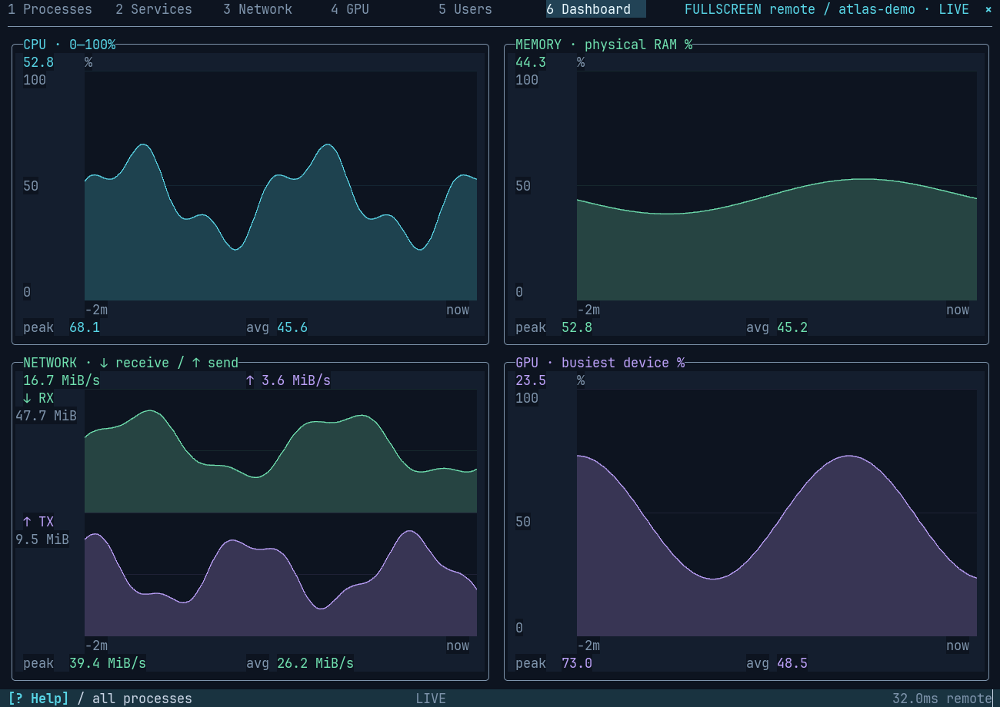
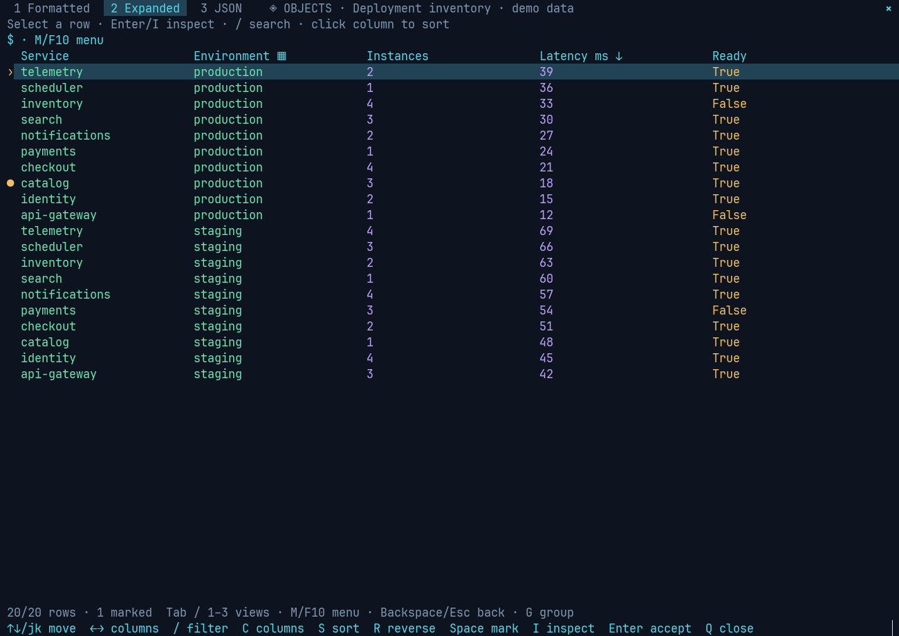
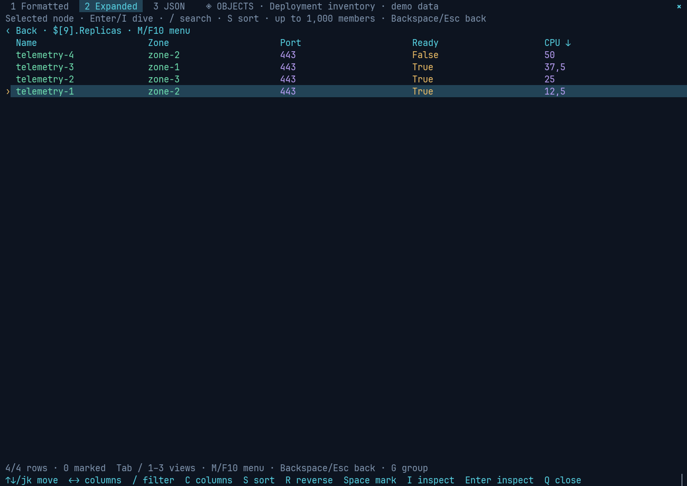
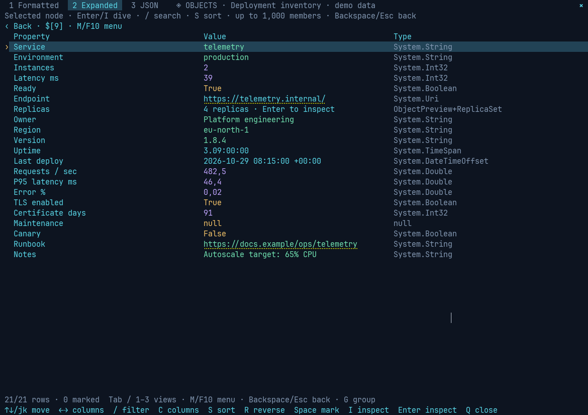
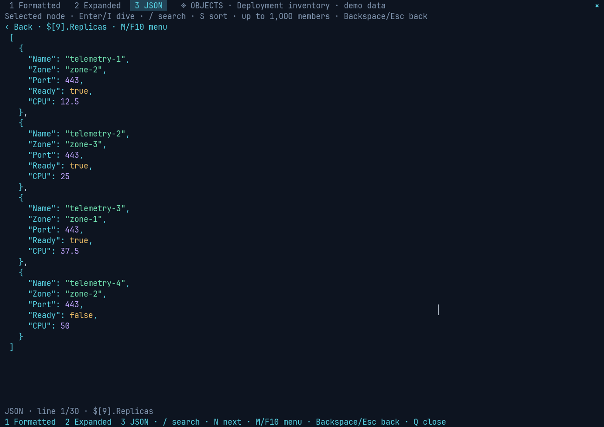
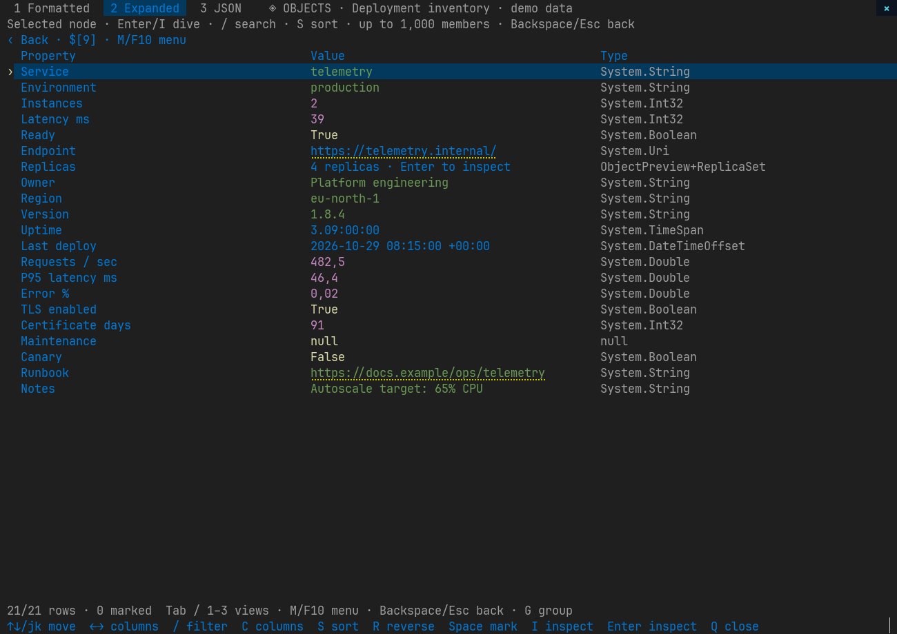
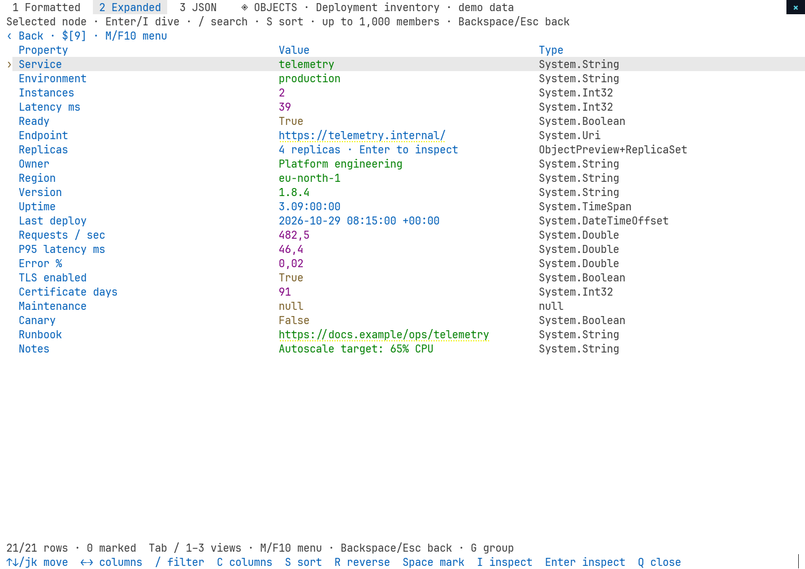
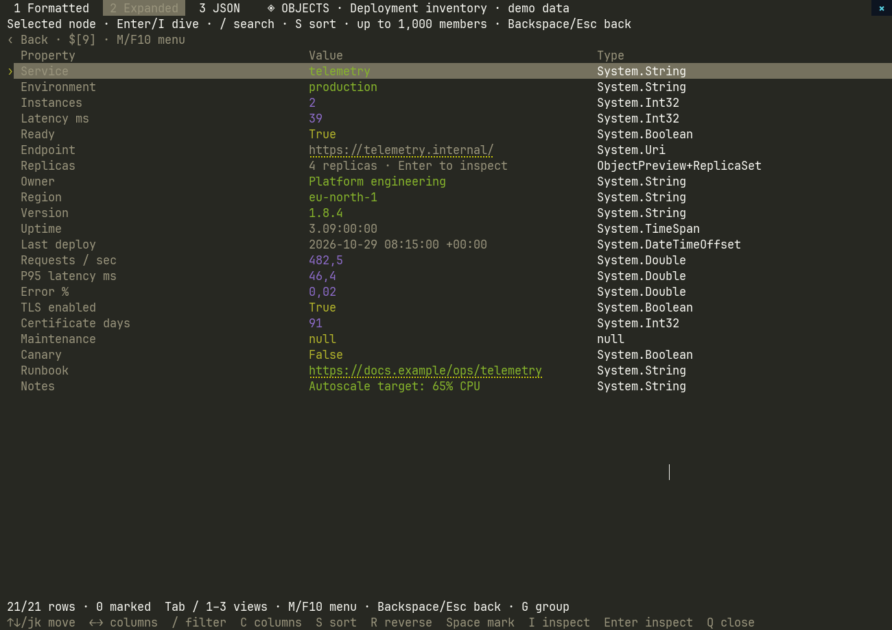
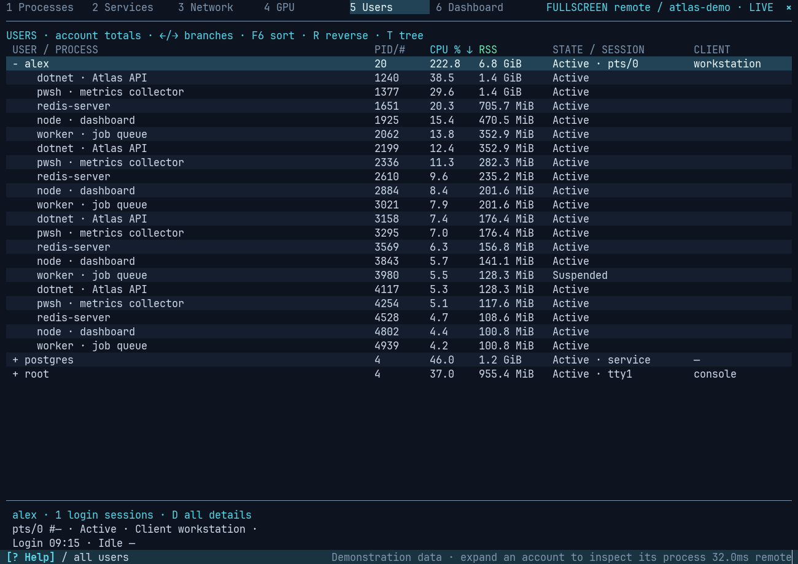
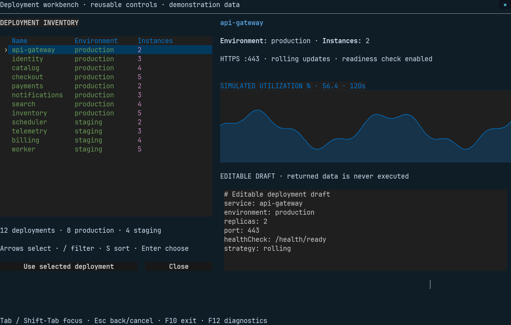

# fullscreen

Interactive terminal apps and a composable TUI framework for PowerShell, built
with [XenoAtom.Terminal.UI](https://xenoatom.github.io/terminal/). Monitor system
activity, browse files and objects, follow logs, manage development work, or
build custom apps with reusable controls and a visual designer.

## Previews



## Install

Requires PowerShell 7.6 or later. Install the module from PowerShell Gallery,
then open the system monitor:

```powershell
Install-Module fullscreen
Import-Module fullscreen
ftop
```

## Cmdlets

| Cmdlet | Alias | Description |
| --- | --- | --- |
| [Show-SystemMonitor](docs/en-US/Show-SystemMonitor.md) | `ftop` | Processes, services, network, GPU and graphs; local or remote. |
| [Show-FileManager](docs/en-US/Show-FileManager.md) | `ffile` | Browse files with previews and return selected paths. |
| [Show-Commander](docs/en-US/Show-Commander.md) | `fmc` | Dual-pane file manager with copy, move and recoverable trash. |
| [Show-ObjectTable](docs/en-US/Show-ObjectTable.md) | `fobject` | Explore pipeline objects, inspect properties and return selections. |
| [Out-Chart](docs/en-US/Out-Chart.md) | | Chart whole pipeline objects; change axes, values and graph type in the TUI. |
| [Show-LogViewer](docs/en-US/Show-LogViewer.md) | `flog` | Follow and filter text or JSON logs. |
| [Show-GitManager](docs/en-US/Show-GitManager.md) | `fgit` | Manage Git changes, history, branches and worktrees; requires `git` on `PATH`. |
| [Show-GitHubManager](docs/en-US/Show-GitHubManager.md) | `fgh` | Review issues, pull requests and workflows; requires an authenticated `gh` CLI. |
| [Show-AzureDevOpsManager](docs/en-US/Show-AzureDevOpsManager.md) | `fado` | Plan backlogs, review sprints, and browse work items, pull requests and pipelines; requires Azure CLI. |
| [Show-TuiDesigner](docs/en-US/Show-TuiDesigner.md) | `fdesign` | Design layouts visually and export PowerShell scaffolding. |
| [Invoke-Tui](docs/en-US/Invoke-Tui.md) | `ftui` | Run a custom TUI with state and PowerShell callbacks. |
| [Get-TuiControl](docs/en-US/Get-TuiControl.md) | — | Discover reusable controls, properties, bindings and events. |
| [New-TuiControl](docs/en-US/New-TuiControl.md) | — | Create a control definition for a custom layout. |
| [New-TuiDefinition](docs/en-US/New-TuiDefinition.md) | — | Create or validate a layout from native PowerShell objects. |
| [Import-TuiDefinition](docs/en-US/Import-TuiDefinition.md) | — | Load a PSD1 or JSON layout. |
| [Export-TuiDefinition](docs/en-US/Export-TuiDefinition.md) | — | Export runnable PowerShell scaffolding, inline or linked to PSD1/JSON. |
| [Get-FullscreenTheme](docs/en-US/Get-FullscreenTheme.md) | — | Discover palettes and customize theme colors. |

Press **F12** in any interactive cmdlet, including while a dialog is open, to
toggle the diagnostic overlay with frame timings and keyboard focus.

### Mouse support

Every app works with the mouse as well as the keyboard:

- **Click** to select rows, tabs, buttons and column headers (to sort); **double-click**
  to open an item, and use the **wheel** to scroll or zoom charts.
- **Right-click** a row, file, process, work item or canvas control for a context
  menu with its actions. Most apps also open it with **A**; the designer uses **F7**.
- **Drag** to rearrange controls in the designer, resize list and detail panes, or
  select a range in a chart with Shift-drag.
- Click **×** in the top-right corner to close the app at any time, even while a
  dialog is open. Apps with unsaved changes ask for confirmation first.

<details>
<summary>Object exploration, user sessions and themes</summary>

| Expanded objects | Nested array with sortable columns |
| --- | --- |
|  |  |

| Property inspector | JSON highlighting |
| --- | --- |
|  |  |

| Dark Modern | Light Modern | Monokai |
| --- | --- | --- |
|  |  |  |

[Object action menu](docs/images/objects-menu.png) ·
[All theme color swatches](docs/images/themes.png) ·
[Grouped control catalog](docs/images/controls.png)



</details>

## Custom TUIs

Build your own apps from reusable controls. Design a layout visually with
[Show-TuiDesigner](docs/en-US/Show-TuiDesigner.md), then save or export with
[Export-TuiDefinition](docs/en-US/Export-TuiDefinition.md). A `.ps1` export embeds
the layout; PSD1/JSON exports also create a companion `.ps1` that loads the layout.
Edit that script's event and update stubs to add your application's behavior.
Use [Get-TuiControl](docs/en-US/Get-TuiControl.md) to discover the available
controls and their properties.

- Use `-LinkedLayout` with a `.ps1` export to keep its layout in a sibling
  `.tui.psd1`. Existing scripts are preserved; updating layout data with the
  cmdlet requires `-Force`. Designer saves ask before replacing layouts.
- Generated scripts accept `-Theme`, `-Minimal`, `-State`, `-TickInterval` and
  `-DefinitionOnly`, for example `./MyTui.ps1 -Minimal -State @{ name = 'Ada' }`.
- Pass jobs, credentials and live objects through `Invoke-Tui -State`; saved
  layouts contain only serializable defaults.
- Handlers run on the UI thread. Run sustained work in a background job and
  dispose it in `finally`; see [BackgroundJob.ps1](examples/BackgroundJob.ps1).
- Charts use Sixel graphics when the terminal supports them and terminal cells
  otherwise.

<details>
<summary>Populated custom TUI example</summary>



</details>

## Examples

The [examples](examples) folder contains runnable scripts. Custom layout scripts
accept `-DefinitionOnly` to return the layout without opening a terminal:

```powershell
./examples/ContactForm.ps1 -Theme 'Dark Modern'
$layout = ./examples/SettingsTabs.ps1 -DefinitionOnly
$layout | Show-TuiDesigner
$layout | Export-TuiDefinition -Path ./settings.tui.psd1
```

| Example | Demonstrates |
| --- | --- |
| [ControlGallery.ps1](examples/ControlGallery.ps1) | Every fullscreen control, handler maps, shared state and selected objects |
| [NativeControls.ps1](examples/NativeControls.ps1) | Native widgets with populated data; filter by name |
| [UserSessions.ps1](examples/UserSessions.ps1) | Login sessions with expandable account processes |
| [ContactForm.ps1](examples/ContactForm.ps1) | Bound inputs, validation and object results |
| [ReusableControls.ps1](examples/ReusableControls.ps1) | Deployment workbench with tables, code, charts and multiline input |
| [Workspace.ps1](examples/Workspace.ps1) | Files, telemetry and logs in tabs |
| [HandlerMap.ps1](examples/HandlerMap.ps1) | Direct event handlers and shared state |
| [DesignerStarter.ps1](examples/DesignerStarter.ps1) | A styled form and chart for the designer |
| [GraphGallery.ps1](examples/GraphGallery.ps1) | All twelve graph styles |
| [ChartCombinations.ps1](examples/ChartCombinations.ps1) | Named multi-line/area series, grouped bars, column/line roles and clickable legends |
| [StackedAreas.ps1](examples/StackedAreas.ps1) | Additive and 100-percent request-outcome areas, missing-component gaps and portable definitions |
| [RadialCharts.ps1](examples/RadialCharts.ps1) | Pie slices, semicircular load gauges, radial lanes and radar comparisons |
| [WaterfallHeatmap.ps1](examples/WaterfallHeatmap.ps1) | Signed cumulative changes and matrix cells with a shared color scale |
| [MarketCharts.ps1](examples/MarketCharts.ps1) | Variable-width Marimekko composition and fixed-price Kagi reversals |
| [Flamegraph.ps1](examples/Flamegraph.ps1) | Hierarchical frames with exclusive self samples and inclusive widths |
| [Gantt.ps1](examples/Gantt.ps1) | Absolute task intervals, progress and milestones |
| [RelationshipCharts.ps1](examples/RelationshipCharts.ps1) | Flow/network layouts with separate node and edge collections |
| [LiveChart.ps1](examples/LiveChart.ps1) | Numeric collections and scale options |
| [ProcessDashboard.ps1](examples/ProcessDashboard.ps1) | Live process data and tick callbacks |
| [BackgroundJob.ps1](examples/BackgroundJob.ps1) | Thread jobs, polling and cleanup |
| [LogTail.ps1](examples/LogTail.ps1) | Bounded file reads and error display |
| [EventViewer.ps1](examples/EventViewer.ps1) | Windows event logs, background queries, filters, resizable panes and event details; optional Windows PSSession |
| [SettingsTabs.ps1](examples/SettingsTabs.ps1) | Settings controls and validated results |
| [CommandHelp.ps1](examples/CommandHelp.ps1) | Local help display |
| [SpectreContent.ps1](examples/SpectreContent.ps1) | Spectre renderables supplied by TextMate or another module |
| [ToolModule.psm1](examples/ToolModule.psm1) | A pipeline picker that returns original objects |
| [NativeLayout.psd1](examples/NativeLayout.psd1) | A portable data-only layout |
| [ISpyBrowser.ps1](examples/ISpyBrowser.ps1) | Assembly browsing with optional TextMate previews |

The eight chart examples from `ChartCombinations.ps1` through
`RelationshipCharts.ps1` accept `-Theme`, `-Minimal` and `-DefinitionsOnly`
(`-DefinitionOnly` is an alias), plus their chart-specific options.
`-DefinitionsOnly` returns a complete portable layout for `Show-TuiDesigner`,
`Export-TuiDefinition` or `Invoke-Tui`; `-DataOnly` still returns original sample
records (separate Nodes/Edges for relationship charts). DataOnly takes precedence
when both output switches are present. Presentation parameters do not change
portable data; pass them to `Invoke-Tui` when running a returned definition.

## Build from source

Building from a source checkout requires PowerShell 7.6 or later and the .NET 10
SDK. The build creates the module in `output/`, generates help and runs the checks:

```powershell
./build.ps1
Import-Module ./output/fullscreen.psd1
```

## Optional integrations

The built-in apps need no other PowerShell modules. These are used when present;
executables must be on `PATH`.

| Dependency | Used by | Setup | Without it |
| --- | --- | --- | --- |
| [TextMate](https://www.powershellgallery.com/packages/TextMate) module | `Code` control; source and Markdown previews | `Install-Module TextMate -Scope CurrentUser` | Source shows as plain text; the `Code` control shows an install notice. |
| [Sixel](https://www.powershellgallery.com/packages/Sixel) module | Image previews in the file browser | `Install-Module Sixel -Scope CurrentUser`, plus a Sixel-capable terminal | A notice explains what is missing. Charts are unaffected. |
| [`git`](https://git-scm.com/) | [Show-GitManager](docs/en-US/Show-GitManager.md) | Install Git. | Git views are unavailable. |
| [GitHub CLI](https://cli.github.com/) (`gh`) | [Show-GitHubManager](docs/en-US/Show-GitHubManager.md) | Install `gh`, then `gh auth login`. | GitHub views are unavailable. |
| [Azure CLI](https://learn.microsoft.com/cli/azure/) (`az`) | [Show-AzureDevOpsManager](docs/en-US/Show-AzureDevOpsManager.md) | `az extension add --name azure-devops`, then `az login`. | Azure DevOps views are unavailable. |

Spectre controls display renderables created by the caller; load the module that
produces them, such as TextMate, first.
