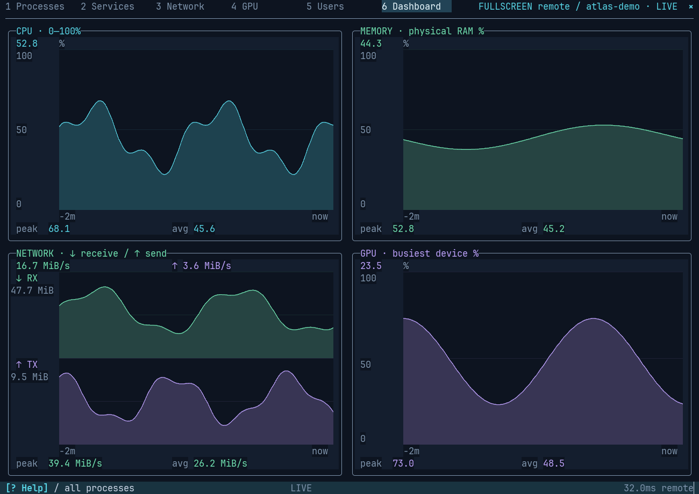

# fullscreen

Interactive terminal apps and reusable TUI controls for PowerShell: monitor a
computer, browse files and objects, follow logs, or build your own terminal app.



## Get started

Requires PowerShell 7.6 or later.

```powershell
Install-Module fullscreen
Import-Module fullscreen
ftop
```

Charts use Sixel when the terminal supports it, with terminal-cell fallback.
Press **?** inside an app for its controls.

## Try it

```powershell
# Monitor hardware and processes.
ftop -View Dashboard

# Explore objects, retaining their original PowerShell types.
Get-Process | fobject

# Plot a pipeline.
Get-Process | Out-Chart -XProperty ProcessName -YProperty WorkingSet64 -GraphType Bars

# Browse files or follow a log.
ffile
flog -Path ./application.log -Follow
```

| App | Command |
| --- | --- |
| System monitor | `ftop` / `Show-SystemMonitor` |
| File browser / dual-pane commander | `ffile` / `fmc` |
| Object explorer | `fobject` / `Show-ObjectTable` |
| Charts | `Out-Chart` |
| Log viewer | `flog` / `Show-LogViewer` |
| Git / GitHub / Azure DevOps | `fgit` / `fgh` / `fado` |
| Visual TUI designer | `fdesign` / `Show-TuiDesigner` |
| Run a custom layout | `ftui` / `Invoke-Tui` |

Git, GitHub and Azure DevOps apps require their respective command-line tools.
See [optional integrations](docs/guides/integrations.md) for setup.

## Build your own TUI

From a source checkout, try a form or open a sample layout in the designer:

```powershell
./examples/ContactForm.ps1
$layout = ./examples/SettingsTabs.ps1 -DefinitionOnly
$layout | Show-TuiDesigner
```

Use `Get-TuiControl` to discover controls. See the
[custom TUI guide](docs/guides/custom-tuis.md) and
[runnable examples](examples/README.md) for composition, callbacks and charts.

## Learn more

- [Documentation](docs/README.md): guides and cmdlet reference
- [System monitor](docs/guides/system-monitor.md)
- [Chart cookbook](docs/guides/charts.md)
- [Control cookbook](docs/guides/controls.md)
- [Terminal graphics and troubleshooting](docs/guides/terminal-graphics.md)

## Build from source

Requires PowerShell 7.6 and the .NET 10 SDK.

```powershell
./build.ps1
Import-Module ./output/fullscreen.psd1
```

[Contributor documentation](docs/maintainers/README.md) covers the build,
help generation and implementation references.
